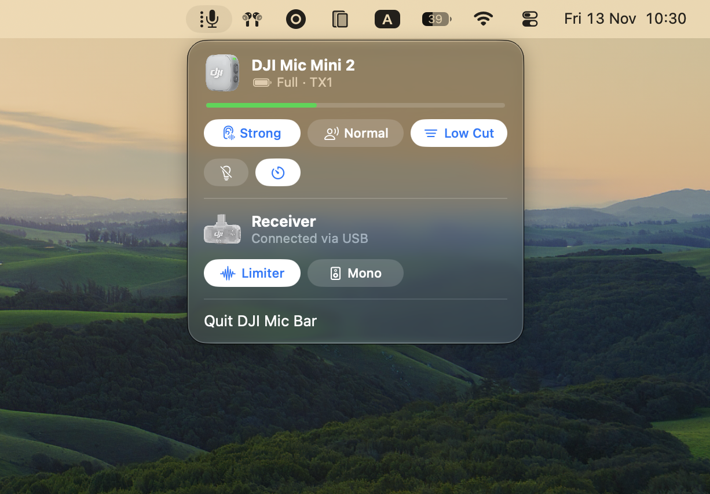

# DJI Mic Bar

A small macOS menu bar app for the **DJI Mic Mini 2**. Plug the USB-C receiver into your Mac and see at a glance whether the microphone is connected, how much battery it has left, and how it is set up — and change the settings without the phone app.



> Built for and tested with one setup only: a DJI Mic Mini 2 transmitter with its USB-C receiver, firmware 02.03.17.00. Other DJI microphones and receivers may partly work, but nothing else has been tried.

## What it shows

- **Menu bar icon** — appears only while the receiver is plugged in. The four dots next to the microphone are a battery gauge for the transmitter (the weakest one, if two are connected).
- **Transmitter** — model picture, battery level, charging state and a live input level bar.
- **Settings as chips** — white means on, grey means off or informational.
- **Firmware and serial numbers** — hold <kbd>Option</kbd> while the panel is open.

## What you can change

| Setting | Where | How |
|---|---|---|
| Voice Tone (Normal / Rich / Bright) | transmitter | menu |
| Low Cut | transmitter | click |
| Mic LEDs | transmitter | click |
| Auto Off after 15 min | transmitter | click |
| Clip Limiter | receiver | click |
| Mono / Stereo | receiver | click |

Noise cancelling is **display only**: the Mic Mini 2 ignores the noise-cancel commands over USB, so the mode has to be switched on the device.

## Requirements

- macOS 13 or later
- Xcode command line tools (`xcode-select --install`)
- The receiver connected over USB — the app talks to the receiver, not to the microphone directly

## Build and run

```sh
./build.sh
open "build/DJI Mic Bar.app"
```

The script compiles the sources with `swiftc` and produces an ad-hoc signed app bundle; there is no Xcode project and no dependencies. To start the app automatically, add it under System Settings → General → Login Items.

## Limitations

- **Battery is a gauge, not a percentage.** The device reports seven levels, shown as Full … Critical.
- **Transmitter settings apply to both transmitters at once**, except Voice Tone.
- **Receiver battery and charging case are not reported** by the known part of the protocol.
- **Only firmware with the newer ("v2") protocol is decoded.** Older firmware shows an "Old firmware" notice.
- **The app holds the receiver's control interface exclusively**, so it cannot run alongside another tool that uses it.
- **The protocol is unofficial** and a firmware update can break it.

## How it works

The receiver exposes a vendor-specific USB interface (number 6) that streams status frames about ten times a second and accepts short command frames. The app reads and writes it through Apple's `IOUSBHost` framework — no drivers, kernel extensions or root access.

| File | Role |
|---|---|
| `Sources/Protocol.swift` | frame parsing, CRC-16, status decoding, command builder |
| `Sources/USBReader.swift` | USB transport and hot-plug handling |
| `Sources/App.swift` | SwiftUI menu bar panel |

## Credits

The wire protocol was reverse-engineered and documented by [ShadowBitBasher/DJI-Mic-Control](https://github.com/ShadowBitBasher/DJI-Mic-Control); this app follows its `PROTOCOL.md`.

This project is not affiliated with or endorsed by DJI. DJI and DJI Mic are trademarks of their owner, and the product images belong to DJI.
